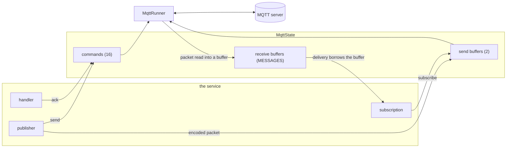
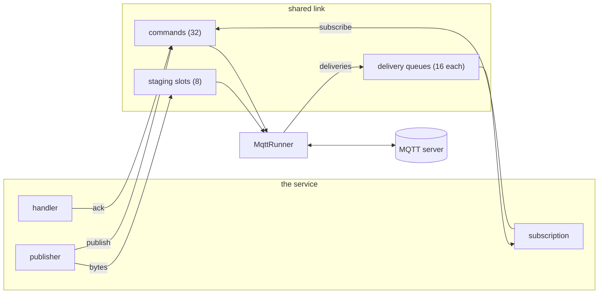

# The runner and the handles

One task, the runner, owns the connection to the server.
The handles of the service (the subscriptions, the publishers and the acknowledgements of the handlers) reach it through storage that exists from the start: on a device the `MqttState` of the board, on the heap variant queues the broker creates when it is built.

## The device variant

The runner is the only code that touches the socket.
It serves one loop: packets from the server, commands from the handles and the keep-alive timer.
Each of the three is a step that completes without waiting for the others, so the acknowledgement of a handler never waits behind a read.

The runner takes a receive buffer from the pool, reads one packet into it, exactly as long as the fixed header says, and decodes it as a view over those bytes.
A PUBLISH goes to the subscription that matches it, and the delivery holds the buffer: its topic and payload are slices of it.
The buffer returns to the pool when the handler settles the delivery.
When every receive buffer is held, the runner stops reading the connection until a handler settles one.
That is the flow control of the device, and the number of buffers is the `MESSAGES` of the [memory](../components/broker/memory.md).

A publish is encoded by the publisher into one of two send buffers and the runner writes it.
The buffer returns to the pool when the runner has written the packet, and a publisher waits for a free one when both are in use.
The runner assigns the packet identifiers of QoS 1 and 2, holds a publish back while the server's receive maximum is reached, and completes the handshakes of QoS 2.

When the connection ends, by a shutdown or by a loss, the runner answers every command that waits, tells every handle the broker is closed, and waits for the next connect.
A handle used after that answers an error and never reports a success the connection did not make.

## The heap variant

The runner is the only code that touches the client.
It serves one loop: packets from the server, commands from the handles and the keep-alive timer.
Each of the three is a step that completes without waiting for the others, so the acknowledgement of a handler never waits behind a read.

A subscription has a queue of 16 deliveries.
When a queue is full, the runner stops reading the connection until the handler takes one.
That is the flow control of the crate.

A publish copies its bytes into one of 8 staging slots and sends the runner a command.
The slot comes back to the pool when the runner has written the packet.
The commands wait in a queue of 32, and a sender waits for room when it is full.

When the connection ends, by a shutdown or by a loss, the runner answers every command that waits, tells every handle the broker is closed, and waits for the next connect.
A handle used after that answers an error and never reports a success the connection did not make.

On a device the runner is a task next to the app's.
On a compio host the broker starts it on the core that connects the broker.
