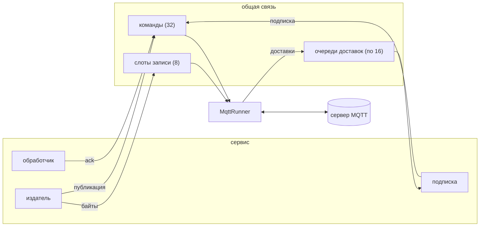

# Runner и ручки

Соединением с сервером владеет одна задача, runner.
Ручки сервиса (подписки, издатели и подтверждения обработчиков) обращаются к ней через хранилище, которое существует с самого начала.

Runner единственный касается клиента.
Он обслуживает один цикл: пакеты протокола от сервера, команды от ручек и таймер keep-alive.
Каждый из трёх шагов завершается, не дожидаясь остальных, поэтому подтверждение обработчика никогда не стоит в очереди за чтением.

У подписки есть очередь из 16 доставок.
Когда очередь полна, runner перестаёт читать соединение, пока обработчик не возьмёт одну.
Это и есть управление потоком в этом крейте.

Публикация копирует свои байты в один из 8 слотов и отправляет runner команду.
Слот возвращается в пул, когда runner записал пакет протокола.
Команды ждут в очереди из 32, а отправитель, если она полна, ждёт места.

Когда соединение заканчивается, по завершению работы или из-за потери, runner отвечает на каждую ожидающую команду, сообщает каждой ручке, что брокер закрыт, и ждёт следующего подключения.
Ручка, использованная после этого, отвечает ошибкой и никогда не сообщает об успехе, которого соединение не совершало.

На устройстве runner работает задачей рядом с задачей приложения.
На хосте compio брокер запускает его на ядре, которое подключает брокер.
