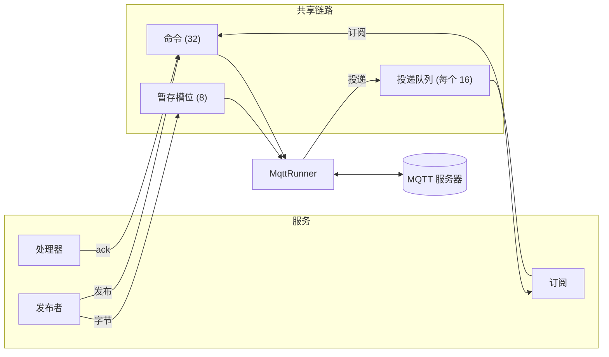

# Runner 与句柄

一个任务，即 runner，持有与服务器的连接。
服务的句柄（订阅、发布者和处理器的确认）通过一开始就存在的存储与它通信。

Runner 是唯一接触客户端的代码。
它服务一个循环：来自服务器的报文、来自句柄的命令和 keep-alive 定时器。
这三者各自是一个不等待其他两者就能完成的步骤，因此处理器的确认不会排在一次读取之后。

每个订阅有一个容量为 16 的投递队列。
队列满时，runner 停止读取连接，直到处理器取走一条。
这就是本 crate 的流量控制。

一次发布把字节复制到 8 个槽位之一，并向 runner 发送一条命令。
Runner 写出报文后，槽位回到池中。
命令在容量为 32 的队列中等待，队列满时发送方等待空位。

连接结束时，无论是因为关闭还是因为丢失，runner 都会回复每一条等待的命令，告诉每个句柄 Broker 已关闭，然后等待下一次连接。
此后再使用的句柄会返回错误，不会报告连接并未完成的成功。

在设备上，runner 是与应用任务并列的一个任务。
在 compio 主机上，Broker 在连接它的核心上启动 runner。
