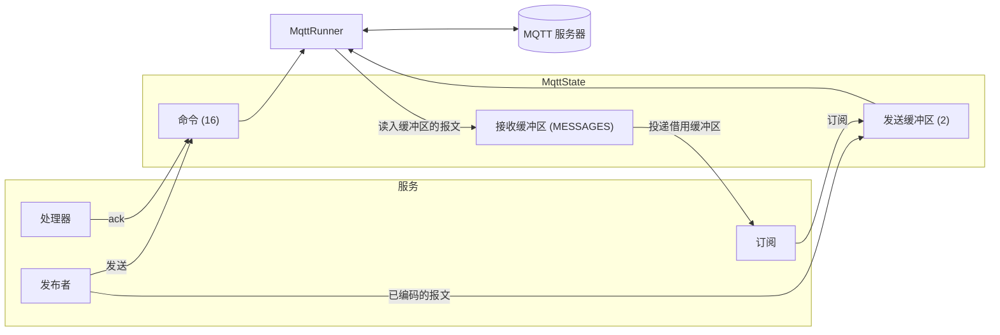
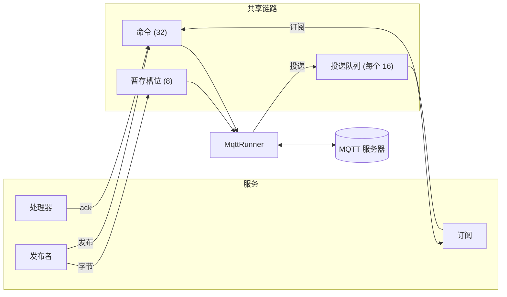

# Runner 与句柄

一个任务，即 runner，持有与服务器的连接。
服务的句柄（订阅、发布者和处理器的确认）通过一开始就存在的存储与它通信：在设备上是开发板的 `MqttState`，在堆变体上是 Broker 构建时创建的队列。

## 设备变体

Runner 是唯一接触套接字的代码。
它服务一个循环：来自服务器的报文、来自句柄的命令和 keep-alive 定时器。
这三者各自是一个不等待其他两者就能完成的步骤，因此处理器的确认不会排在一次读取之后。

Runner 从池中取一个接收缓冲区，向其中读入一个报文，长度恰好等于固定报头所声明的长度，再把它解码为这些字节上的视图。
PUBLISH 交给与之匹配的订阅，投递持有该缓冲区：它的主题和载荷都是缓冲区的切片。
处理器结算投递后，缓冲区回到池中。
当所有接收缓冲区都被持有时，runner 停止读取连接，直到某个处理器结算一条投递。
这就是设备的流量控制，缓冲区的数量就是[内存](../components/broker/memory.md)的 `MESSAGES`。

发布者把一次发布编码进两个发送缓冲区之一，由 runner 写出。
Runner 写出报文后，缓冲区回到池中；两个缓冲区都在使用时，发布者等待空闲的缓冲区。
Runner 分配 QoS 1 和 2 的报文标识符，在达到服务器的接收上限时暂缓发布，并完成 QoS 2 的握手。

连接结束时，无论是因为关闭还是因为丢失，runner 都会回复每一条等待的命令，告诉每个句柄 Broker 已关闭，然后等待下一次连接。
此后再使用的句柄会返回错误，不会报告连接并未完成的成功。

## 堆变体

Runner 是唯一接触客户端的代码。
它服务一个循环：来自服务器的报文、来自句柄的命令和 keep-alive 定时器。
这三者各自是一个不等待其他两者就能完成的步骤，因此处理器的确认不会排在一次读取之后。

每个订阅有一个容量为 16 的投递队列。
队列满时，runner 停止读取连接，直到处理器取走一条。
这就是本 crate 的流量控制。

一次发布把字节复制到 8 个槽位之一，并向 runner 发送一条命令。
Runner 写出报文后，槽位回到池中。
命令在容量为 32 的队列中等待，队列满时发送方等待空位。

连接结束时，无论是因为关闭还是因为丢失，runner 都会回复每一条等待的命令，告诉每个句柄 Broker 已关闭，然后等待下一次连接。
此后再使用的句柄会返回错误，不会报告连接并未完成的成功。

在设备上，runner 是与应用任务并列的一个任务。
在 compio 主机上，Broker 在连接它的核心上启动 runner。
